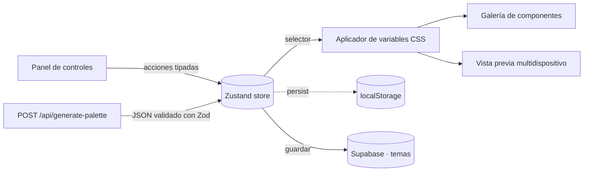

# Theme Studio

Editor visual de temas que aplica tus decisiones de diseño **en tiempo real** sobre una galería de componentes, con vista previa simultánea en móvil, tableta y escritorio.

> Demo: pendiente de despliegue (Fase 6).

## Problema que resuelve

Elegir una paleta, una escala tipográfica y un radio de borde "a ojo" y descubrir en producción que la interfaz se rompe en móvil. Theme Studio separa las decisiones de diseño (tokens) de su aplicación: editas tokens, ves el resultado en tres anchos reales y exportas el tema como CSS, JSON o configuración de Tailwind.

## Funciones principales

- Editor de tokens: colores, tipografía, radios, bordes, espaciado y densidad.
- Vista previa multidispositivo (375 / 768 / 1280 px y ancho libre) con container queries.
- Deshacer / rehacer con historial acotado y atajos de teclado.
- Verificador de contraste WCAG 2.x con corrección sugerida.
- Generación de paletas con IA, validada del lado del cliente.
- Guardar, duplicar, exportar e importar temas; compartir por enlace de solo lectura.

## Stack

| Área        | Tecnología                            | Motivo                                          |
| ----------- | ------------------------------------- | ----------------------------------------------- |
| Build       | Vite + React 18 + TypeScript strict   | Feedback loop rápido y tipado real              |
| Estilos     | Tailwind CSS + variables CSS          | Tokens en runtime sin CSS-in-JS                 |
| Componentes | shadcn/ui (Radix UI)                  | Accesibilidad de Radix sin lock-in              |
| Estado      | Zustand                               | Store pequeño, selectores granulares            |
| Validación  | Zod                                   | Una sola fuente de verdad para datos externos   |
| Backend     | Supabase (Postgres + Auth + RLS)      | Persistencia y autorización sin servidor propio |
| IA          | Función serverless + API de Anthropic | La clave nunca llega al navegador               |
| Pruebas     | Vitest + Testing Library + Playwright | Unidad, componentes y flujo E2E                 |

Decisiones y alternativas descartadas: [`docs/DECISIONS.md`](docs/DECISIONS.md).

## Arquitectura



Detalle en [`docs/ARCHITECTURE.md`](docs/ARCHITECTURE.md).

## Ejecutar en local

Requisitos: Node 20.19+ y npm 10+.

```bash
npm install
cp .env.example .env   # rellena Supabase; la clave de IA solo va en el servidor
npm run dev
```

Comandos:

| Comando                 | Qué hace                            |
| ----------------------- | ----------------------------------- |
| `npm run dev`           | Servidor de desarrollo              |
| `npm run build`         | Typecheck + build de producción     |
| `npm run preview`       | Sirve el build                      |
| `npm run lint`          | ESLint (0 warnings permitidos)      |
| `npm run typecheck`     | `tsc --noEmit`                      |
| `npm test`              | Vitest una vez                      |
| `npm run test:coverage` | Vitest con cobertura                |
| `npm run test:e2e`      | Playwright (reflujo y persistencia) |

Antes de la primera ejecución E2E: `npx playwright install chromium`.

### Docker

```bash
docker build -t theme-studio .
docker run --rm -p 8080:80 theme-studio
```

## Pruebas

Ver [`docs/TESTING.md`](docs/TESTING.md).

## Seguridad

- La clave de Anthropic vive solo en la función serverless (`api/`), nunca en el bundle.
- El cliente usa únicamente la clave `anon` de Supabase; RLS restringe cada fila a su dueño.
- Todo dato externo (respuesta de IA, JSON importado, enlaces compartidos) se valida con Zod.

## Limitaciones conocidas

- Pendiente de completar al cerrar la Fase 6.

## Lo que aprendí

- Pendiente de completar al cerrar la Fase 6.

## Licencia

MIT.
