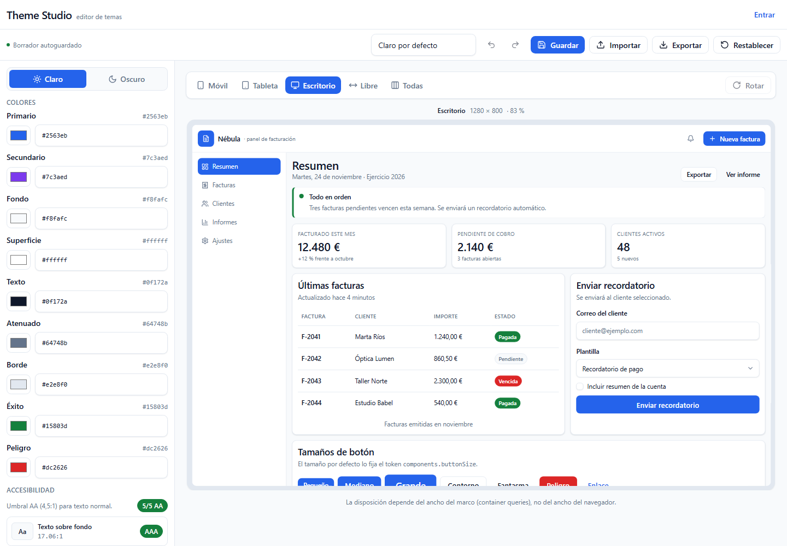
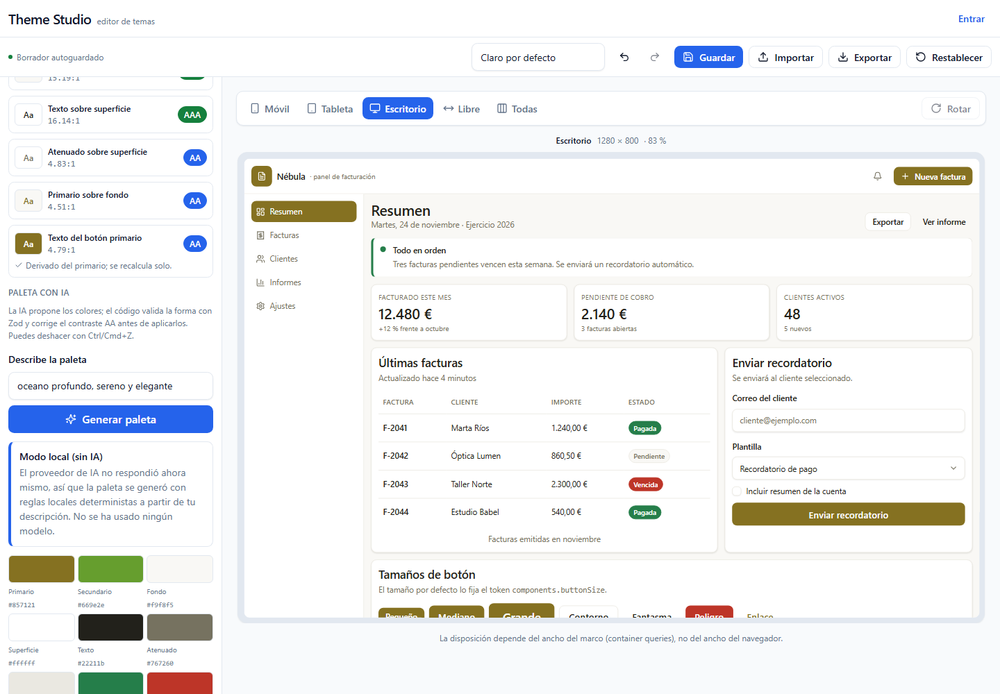
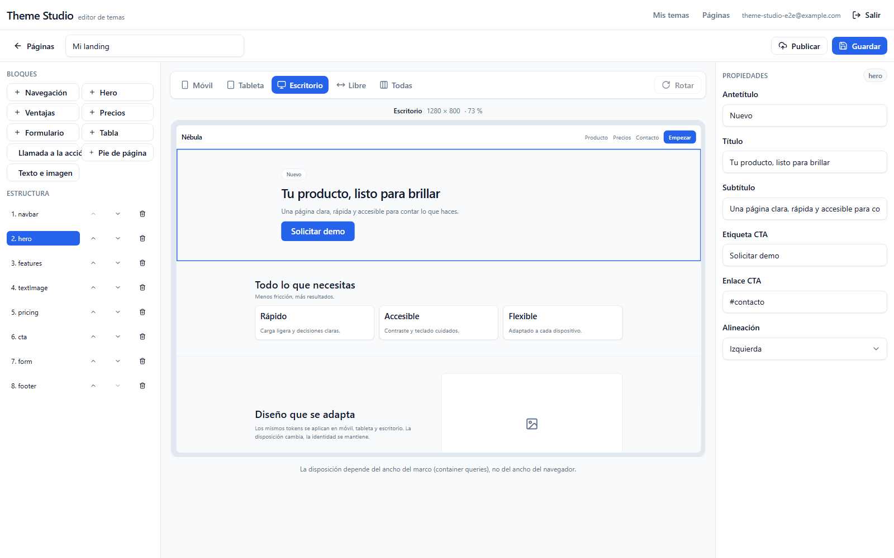
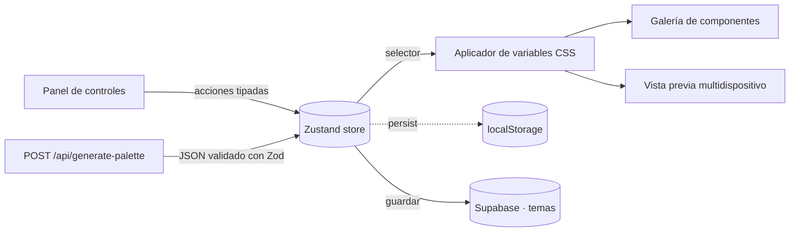

# Theme Studio

[](https://github.com/DanielCB096/theme-studio/actions/workflows/ci.yml)
[](https://theme-studio-queserabernal.vercel.app)

Editor visual de temas que aplica tus decisiones de diseño **en tiempo real** sobre una galería de componentes, con vista previa simultánea en móvil, tableta y escritorio.

> Demo: **https://theme-studio-queserabernal.vercel.app** — editor de temas y Page Builder (`/pages`).





## Problema que resuelve

Elegir una paleta, una escala tipográfica y un radio de borde "a ojo" y descubrir en producción que la interfaz se rompe en móvil. Theme Studio separa las decisiones de diseño (tokens) de su aplicación: editas tokens, ves el resultado en tres anchos reales y exportas el tema como CSS, JSON o configuración de Tailwind.

## Funciones principales

- Editor de tokens: colores, tipografía, radios, bordes, espaciado y densidad.
- Vista previa multidispositivo (375 / 768 / 1280 px y ancho libre) con container queries.
- Deshacer / rehacer con historial acotado y atajos de teclado.
- Verificador de contraste WCAG 2.x con corrección sugerida.
- Variante clara/oscura derivada conservando la identidad de color.
- Generación de paletas con IA, validada y corregida antes de aplicarla.
- Guardar, duplicar, exportar e importar temas; compartir por enlace de solo lectura.
- **Constructor de páginas**: landing desde plantilla, 9 tipos de bloque, edición de contenido, publicación en `/p/:slug` y vista previa móvil/tableta/escritorio.
- **Formularios con respuestas**: envío real desde páginas publicadas, bandeja del dueño con leídas/no leídas y exportación CSV.

## Constructor de páginas

Con una cuenta, entra en **Páginas → Nueva página**: se crea una landing desde plantilla con nueve tipos de bloque (navbar, hero, features, pricing, form, table, cta, footer, textImage). Puedes añadir, reordenar y eliminar bloques, editar sus propiedades, verla en móvil/tableta/escritorio, guardarla en Supabase y publicarla en `/p/:slug`.

El bloque **form** es una demostración en el builder. En una página publicada envía de verdad a `POST /api/submit-page-form` (honeypot y rate limit), guarda la respuesta en Supabase con RLS y la muestra en `/pages/:id/respuestas`, donde puedes marcarla como leída o eliminarla y descargar un CSV. Límites del Hito 2A: sin correo, adjuntos ni captcha.



Guía y alcance: [`docs/PAGE_BUILDER.md`](docs/PAGE_BUILDER.md).

## Stack

| Área        | Tecnología                            | Motivo                                          |
| ----------- | ------------------------------------- | ----------------------------------------------- |
| Build       | Vite + React 18 + TypeScript strict   | Feedback loop rápido y tipado real              |
| Estilos     | Tailwind CSS + variables CSS          | Tokens en runtime sin CSS-in-JS                 |
| Componentes | shadcn/ui (Radix UI)                  | Accesibilidad de Radix sin lock-in              |
| Estado      | Zustand                               | Store pequeño, selectores granulares            |
| Validación  | Zod                                   | Una sola fuente de verdad para datos externos   |
| Backend     | Supabase (Postgres + Auth + RLS)      | Persistencia y autorización sin servidor propio |
| IA          | Función serverless + API de Gemini    | Clave y cuota solo en servidor                  |
| Pruebas     | Vitest + Testing Library + Playwright | Unidad, componentes y flujo E2E                 |

Decisiones y alternativas descartadas: [`docs/DECISIONS.md`](docs/DECISIONS.md).
Alcance del Page Builder: **Anexo A** en [`AGENTS.md`](AGENTS.md) y guía técnica en [`docs/PAGE_BUILDER.md`](docs/PAGE_BUILDER.md).

## Arquitectura



Detalle en [`docs/ARCHITECTURE.md`](docs/ARCHITECTURE.md).

## Qué hace la IA y qué hace el código propio

**La IA** interpreta una descripción en lenguaje natural («atardecer mediterráneo, sereno y cálido») y propone nueve colores con una forma concreta.

**El código** hace todo lo demás:

- Valida el prompt con Zod (3–200 caracteres) y limita a 8 peticiones por IP cada 10 minutos.
- Llama a Gemini (nivel gratuito) con timeout y sin exponer la clave (vive solo en la función serverless).
- Extrae el objeto JSON de la respuesta (aunque venga con markdown) y lo valida con Zod.
- Vuelve a validar en el cliente antes de enseñar nada.
- Corrige automáticamente el contraste AA de texto y primario, conservando el tono.
- No aplica nada hasta que pulsas «Aplicar»; queda en el historial para deshacer.

Una respuesta inválida no modifica el tema: se muestra el error y tu trabajo sigue intacto.

**Reserva local.** Si el proveedor no responde (el nivel gratuito devuelve 503 con frecuencia), la función prueba otros modelos y, como último recurso, genera una paleta determinista a partir del prompt. La interfaz la marca como «Modo local (sin IA)»: nunca se presenta como generación del modelo. Esa paleta también pasa por la validación y la corrección de contraste.

**Caché en dos capas.** Las paletas reales se guardan 24 h en memoria de la función (50 entradas por instancia) y en `localStorage` del navegador (20 entradas). Repetir el mismo prompt no consume cuota ni vuelve a llamar al modelo; la UI indica cuando la paleta viene de caché. La reserva local no se cachea, para que el siguiente intento pueda volver a usar la IA.

## Ejecutar en local

Requisitos: Node 20.19+ y npm 10+.

```bash
npm install
cp .env.example .env   # rellena Supabase; la clave de IA solo va en el servidor
npm run dev
```

La IA usa una función serverless. En local, `npm run dev` sirve también `/api/*` con un plugin de Vite que lee `.env` (incluidas `GEMINI_API_KEY` y `GEMINI_MODEL`); `vercel dev` sigue siendo la alternativa para reproducir el entorno de producción. Los formularios usan además `VITE_SUPABASE_URL` y `VITE_SUPABASE_ANON_KEY`.

Comandos:

| Comando                 | Qué hace                               |
| ----------------------- | -------------------------------------- |
| `npm run dev`           | Servidor de desarrollo                 |
| `npm run build`         | Typecheck + build de producción        |
| `npm run preview`       | Sirve el build                         |
| `npm run lint`          | ESLint (0 warnings permitidos)         |
| `npm run typecheck`     | `tsc --noEmit`                         |
| `npm test`              | Vitest una vez                         |
| `npm run test:coverage` | Vitest con cobertura                   |
| `npm run test:e2e`      | Playwright (reflujo, auth y compartir) |
| `npm run verify:rls`    | Matriz RLS con dos usuarios reales     |

Antes de la primera ejecución E2E: `npx playwright install chromium`.

Las pruebas E2E de auth y compartición necesitan `.env` con el proyecto Supabase y «Confirm email» desactivado (ver [`docs/TESTING.md`](docs/TESTING.md)).

### Docker

```bash
docker build -t theme-studio .
docker run --rm -p 8080:80 theme-studio
```

Para incluir la configuración de Supabase en el build (como secreto de BuildKit, sin dejarla en capas):

```bash
docker build --secret id=vite_env,src=.env -t theme-studio .
docker run --rm -p 8080:80 theme-studio
```

## Métricas

| Métrica                           | Valor                                                     |
| --------------------------------- | --------------------------------------------------------- |
| Cobertura `src/lib` + `src/store` | 93,75 % de líneas · 92,07 % de ramas                      |
| Lighthouse · Accesibilidad        | 100                                                       |
| Lighthouse · Buenas prácticas     | 100                                                       |
| Lighthouse · SEO                  | 100                                                       |
| Chunk mayor                       | 231 kB (60 kB gzip, vendor Supabase)                      |
| Pruebas                           | 209 unitarias/componentes · 8 E2E (Page Builder) · 14 RLS |
| Respuesta de la IA                | 2–22 s según el modelo disponible; reserva local si falla |

## Pruebas

Ver [`docs/TESTING.md`](docs/TESTING.md).

## Seguridad

- La clave de Gemini vive solo en la función serverless (`api/`), nunca en el bundle.
- El cliente usa únicamente la clave pública (`publishable`/`anon`) de Supabase; RLS restringe cada fila a su dueño. La matriz se verifica con dos usuarios reales (`npm run verify:rls`).
- Las respuestas de formulario se insertan con la clave `anon` a través de `POST /api/submit-page-form`; RLS solo permite escribir si la página es pública y solo el dueño puede leerlas, marcarlas o eliminarlas. El endpoint aplica Zod, honeypot y rate limit.
- Las políticas de `update` incluyen `with check`, así que un dueño no puede transferir sus filas a otro usuario.
- Todo dato externo (respuesta de IA, JSON importado, enlaces compartidos, `data` leído de la base de datos) se valida con Zod.
- **En la demo** «Confirm email» está desactivado en Supabase para permitir el registro automatizado. Antes de un uso real hay que reactivarlo (ADR-010).

## Limitaciones conocidas

- **Enlace mágico en producción**: su destino depende de _Redirect URLs_ en Supabase. Si no añades `https://theme-studio-queserabernal.vercel.app/**`, el correo apuntará a `localhost`. El acceso con contraseña sí funciona en la demo.
- El nivel gratuito de Gemini devuelve 503 con frecuencia; la función prueba varios modelos y, si todos fallan, responde con la reserva local etiquetada como tal.
- Los formularios del Hito 2A no envían correo ni aceptan adjuntos; el rate limit es en memoria y no sustituye a un captcha. La bandeja no tiene paginación.
- El rate limit de la IA vive en memoria: no es global entre instancias serverless ni sustituye a una cuota de producción.
- «Confirm email» está desactivado en Supabase para permitir los E2E; es un tradeoff de demo, no una configuración recomendable en producción.
- Los E2E usan una cuenta fija (`theme-studio-e2e@example.com`) y crean temas de prueba; los temas se pueden borrar desde la cuenta y las cuentas antiguas desde el dashboard.
- Tailwind 3: la migración a Tailwind 4 (`@theme`) queda como mejora futura.
- El SDK de Supabase se carga en el bundle inicial; se podría diferir hasta la primera acción de cuenta.

## Lo que aprendí

- **Las container queries bastan para una vista previa propia**, pero jsdom no calcula CSS: sin Playwright, el reflujo por ancho sería una promesa sin evidencia.
- **RLS se demuestra con dos usuarios reales**, no con la interfaz. Añadir `with check` al `update` fue la diferencia entre «no ves filas ajenas» y «no puedes apropiártelas».
- **La salida de un modelo necesita validación doble y una corrección posterior**: la paleta más bonita es inútil si el texto no se lee.
- **El historial necesita coalescencia**: sin agrupar arrastres, deshacer deja de ser una herramienta y se convierte en un castigo.
- **Aislar el proveedor de IA en una función** permitió cambiar de Anthropic a Gemini sin tocar el editor y sin poner la clave en el navegador. Añadir una reserva local hizo que la demo sobreviviera a los 503 del nivel gratuito sin mentir al usuario.

## Licencia

MIT.
