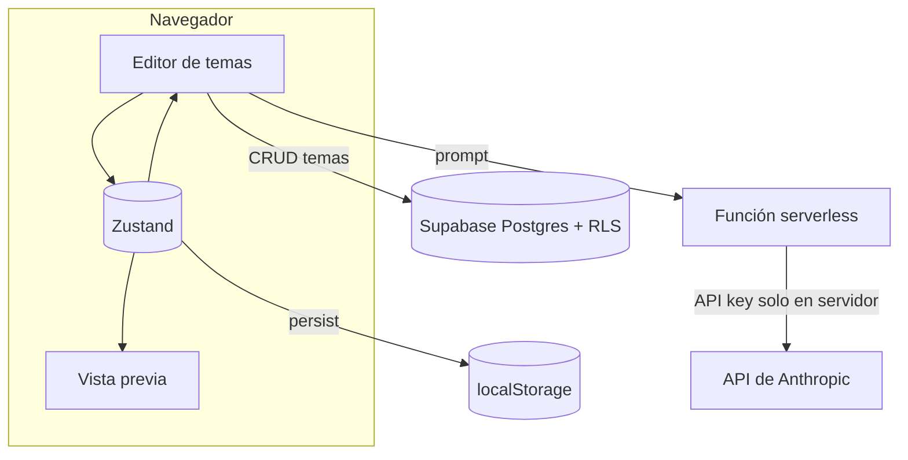

# Arquitectura

Este documento describe cómo se conectan las piezas de Theme Studio. Se actualiza al final de cada fase.

## Diagrama de contenedores



## Sistema de tokens

Un tema es un objeto validado con Zod que se traduce a variables CSS mediante `themeToCssVars` (`src/lib/tokens.ts`). No se genera CSS: las variables viajan en el atributo `style` del contenedor de la vista previa.

```
Theme (TS)  ──themeToCssVars──▶  { "--color-primary": "#2563eb", "--radius": "10px", … }
                                        │
                          style={…} en <ThemeScope>
                                        │
             Tailwind:  bg-primary → background-color: var(--color-primary)
```

| Variable                                | Origen                      | Ejemplo         |
| --------------------------------------- | --------------------------- | --------------- |
| `--color-primary`, `--color-surface`, … | `theme.colors`              | `#2563eb`       |
| `--color-primary-contrast`              | derivada por luminancia     | `#ffffff`       |
| `--font-family`                         | lista blanca `FONT_STACKS`  | pila de sistema |
| `--font-size-base`, `--font-size-lg`, … | `baseSize` y `scale`        | `16px`, `20px`  |
| `--radius`, `--border-width`            | `theme.shape`               | `10px`, `1px`   |
| `--space-unit`, `--density-gap`         | `spacing.unit` y `density`  | `4px`, `12px`   |
| `--btn-height-*`, `--btn-padding-*`     | tamaño de botón y espaciado | `32px`, `12px`  |

`tailwind.config.ts` no contiene colores propios: mapea cada clase a `var(--…)`. Por eso `bg-primary` sigue siendo válido aunque el valor cambie en caliente.

Los tokens de `:root` (en `src/index.css`) gobiernan el chrome del editor y sirven de valor por defecto si no hay un `ThemeScope`.

### Galería de componentes

`src/features/preview/GalleryApp.tsx` es una aplicación de muestra (panel de facturación) que ejercita botones en tres tamaños, inputs, select, checkbox, tarjetas, tabla, alerta, navegación lateral y modal. Se reorganiza con **container queries** (`@container`, `@2xl:`, …) porque en la vista previa importa el ancho del marco, no el del viewport. La tabla se convierte en lista de tarjetas y la navegación lateral pasa a un menú desplegable cuando el contenedor es estrecho.

## Decisiones

Cada decisión con sus alternativas está en [`DECISIONS.md`](DECISIONS.md).

## Convenciones de código

- TypeScript `strict` con `noUncheckedIndexedAccess`; `any` prohibido por ESLint.
- Alias `@/` para `src/`.
- Nombres y commits en inglés; documentación en español.
- Componentes de `src/components/ui` son shadcn/ui (Radix + Tailwind) y no contienen colores literales.
