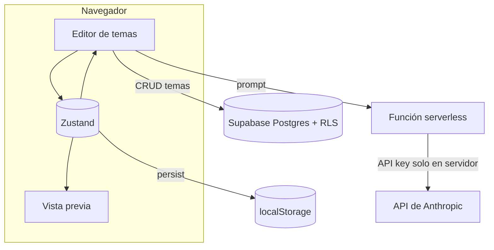

# Arquitectura

Este documento describe cómo se conectan las piezas de Theme Studio. Se actualiza al final de cada fase.

## Diagrama de contenedores

## Decisiones

Cada decisión con sus alternativas está en [`DECISIONS.md`](DECISIONS.md).

## Convenciones de código

- TypeScript `strict` con `noUncheckedIndexedAccess`; `any` prohibido por ESLint.
- Alias `@/` para `src/`.
- Nombres y commits en inglés; documentación en español.
- Componentes de `src/components/ui` son shadcn/ui (Radix + Tailwind) y no contienen colores literales.
