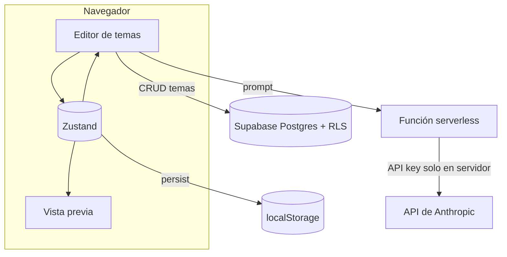
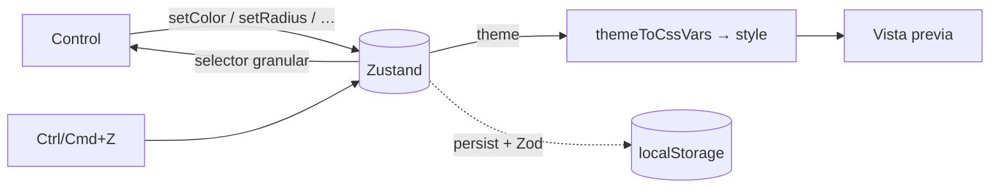
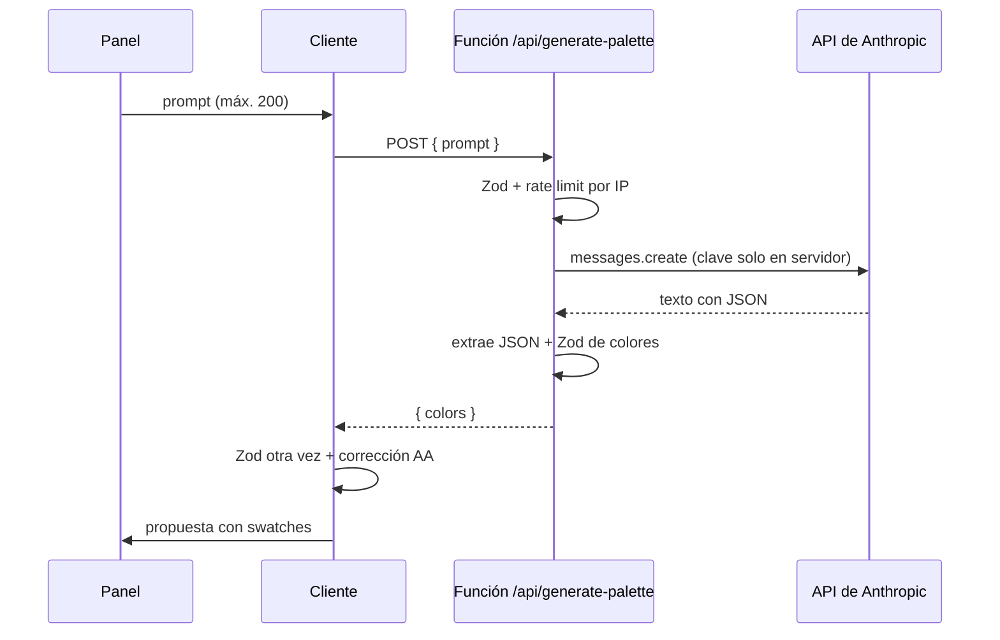
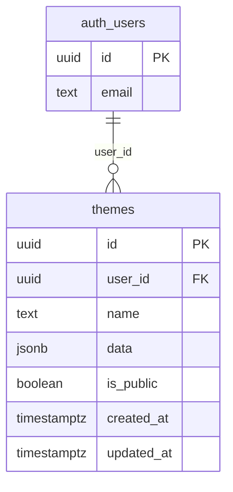

# Arquitectura

Este documento describe cómo se conectan las piezas de Theme Studio. Se actualiza al final de cada fase.

## Diagrama de contenedores



## Sistema de tokens

Un tema es un objeto validado con Zod que se traduce a variables CSS mediante `themeToCssVars` (`src/lib/tokens.ts`). No se genera CSS: las variables viajan en el atributo `style` del contenedor de la vista previa.

```
Theme (TS)  ──themeToCssVars──▶  { "--color-primary": "#2563eb", "--radius": "10px", … }
                                        │
                          style={…} en <ThemeScope>
                                        │
             Tailwind:  bg-primary → background-color: var(--color-primary)
```

| Variable                                | Origen                      | Ejemplo         |
| --------------------------------------- | --------------------------- | --------------- |
| `--color-primary`, `--color-surface`, … | `theme.colors`              | `#2563eb`       |
| `--color-primary-contrast`              | derivada por luminancia     | `#ffffff`       |
| `--font-family`                         | lista blanca `FONT_STACKS`  | pila de sistema |
| `--font-size-base`, `--font-size-lg`, … | `baseSize` y `scale`        | `16px`, `20px`  |
| `--radius`, `--border-width`            | `theme.shape`               | `10px`, `1px`   |
| `--space-unit`, `--density-gap`         | `spacing.unit` y `density`  | `4px`, `12px`   |
| `--btn-height-*`, `--btn-padding-*`     | tamaño de botón y espaciado | `32px`, `12px`  |

`tailwind.config.ts` no contiene colores propios: mapea cada clase a `var(--…)`. Por eso `bg-primary` sigue siendo válido aunque el valor cambie en caliente.

Los tokens de `:root` (en `src/index.css`) gobiernan el chrome del editor y sirven de valor por defecto si no hay un `ThemeScope`.

### Galería de componentes

`src/features/preview/GalleryApp.tsx` es una aplicación de muestra (panel de facturación) que ejercita botones en tres tamaños, inputs, select, checkbox, tarjetas, tabla, alerta, navegación lateral y modal. Se reorganiza con **container queries** (`@container`, `@2xl:`, …) porque en la vista previa importa el ancho del marco, no el del viewport. La tabla se convierte en lista de tarjetas y la navegación lateral pasa a un menú desplegable cuando el contenedor es estrecho.

## Vista previa multidispositivo

`DevicePreview` mantiene un estado local (no del tema) con el modo, la orientación y el ancho libre:

| Modo       | Tamaño            | Notas                         |
| ---------- | ----------------- | ----------------------------- |
| Móvil      | 375 × 812         | Rotable a 812 × 375           |
| Tableta    | 768 × 1024        | Rotable                       |
| Escritorio | 1280 × 800        | No rota                       |
| Libre      | 320–1440 × 900    | Ancho con control arrastrable |
| Todas      | los tres a la vez | Comparación lado a lado       |

Cada `DeviceFrame` mide su hueco con `ResizeObserver` y aplica `transform: scale()` si el dispositivo no cabe. El contenido se renderiza con el ancho real del dispositivo, por lo que las container queries (no las media queries del navegador) deciden cuándo la navegación lateral pasa a menú y cuándo la tabla pasa a tarjetas.

```
marco (ancho medido) ──scale──▶ pantalla (375/768/1280 px) ──@container──▶ galería
```

Prueba E2E (`e2e/preview.spec.ts`): a 375 px comprueba que la barra lateral y la tabla están ocultas y el menú y las tarjetas visibles; a 1280 px, lo contrario. jsdom no calcula CSS, así que esta comprobación solo tiene sentido en un navegador real.

## Flujo de datos del editor



- Cada control se suscribe a **su** campo (`state.theme.shape.radius`), no al tema completo; mover un slider solo repinta la vista previa.
- `commit` guarda el estado anterior en `past` (máx. 50) y limpia `future`. Cambios de la misma propiedad dentro de 600 ms se agrupan en un paso de historial, para que arrastrar un slider no genere cientos de entradas.
- `undo`/`redo` mueven el tema entre `past` y `future`; cualquier cambio nuevo descarta el futuro.
- `persist` guarda solo `theme`. Al rehidratar, el JSON de localStorage se valida con Zod: un borrador corrupto o de otra versión se descarta en lugar de romper la app.
- El atajo global ignora los campos de texto, donde el deshacer debe ser el nativo del navegador.

## Paleta con IA



Tres barreras antes de tocar el tema:

1. **Servidor**: prompt validado; la clave vive en `ANTHROPIC_API_KEY` y nunca se serializa al cliente.
2. **Servidor**: la respuesta del modelo se recorta a su objeto JSON y se valida con Zod; un color mal formado produce 502, no una paleta a medias.
3. **Cliente**: se valida de nuevo y se corrige el contraste con `ensureAccessibleColors` antes de mostrar «Aplicar».

Límites: 8 peticiones por IP cada 10 minutos (mapa en memoria, best-effort en serverless), timeout de 20 s en servidor y 25 s en cliente, y modelo obligatorio en `ANTHROPIC_MODEL` para no fijar un nombre que caduque.

## Variante automática de modo

`deriveVariant` reconstruye los neutros con el tono del fondo actual y la luminosidad del modo destino; después ajusta texto, atenuado y colores de marca hasta cumplir contraste (7:1 para texto, 4.5:1 para marcas). El tono de las marcas se conserva, así que cambiar de claro a oscuro mantiene la identidad.

## Modelo de datos y RLS



`data` guarda el `Theme` completo. Al leerlo se valida otra vez con Zod: una fila manipulada o de una versión antigua produce un error legible en lugar de romper la interfaz.

| Operación         | anon | Dueño autenticado         | Otro usuario autenticado |
| ----------------- | ---- | ------------------------- | ------------------------ |
| Leer tema privado | ✗    | ✓                         | ✗                        |
| Leer tema público | ✓    | ✓                         | ✓                        |
| Insertar          | ✗    | ✓ (solo `user_id` propio) | ✗                        |
| Actualizar        | ✗    | ✓                         | ✗                        |
| Borrar            | ✗    | ✓                         | ✗                        |

Las políticas incluyen `with check` en `update`: sin él, un dueño podría reasignar `user_id` y transferir la fila. La matriz se verifica con `npm run verify:rls` sobre dos usuarios reales (9 comprobaciones).

## Autenticación y sesión

- `AuthSync` se monta una vez, recupera la sesión y escucha `onAuthStateChange`.
- Dos métodos: enlace mágico (`signInWithOtp`) y correo + contraseña (`signInWithPassword` / `signUp`).
- `ProtectedRoute` espera a que termine la carga; si no hay sesión redirige a `/entrar?redirect=…`.
- `safeRedirect` solo acepta rutas internas, para evitar open redirects.
- La sesión la gestiona el SDK de Supabase en localStorage; nunca guardamos tokens a mano.

## Guardado y compartición

`saveTheme` intenta actualizar la fila con el id actual. Si RLS no devuelve fila (no existe, es ajena o el id no es un UUID), inserta una copia con un id nuevo. Consecuencia: guardar nunca puede sobrescribir un tema ajeno, aunque el JSON importado traiga ese id.

Compartir activa `is_public`. `/t/:id` es público y de solo lectura; «Duplicar a mi cuenta» exige sesión y crea una copia propia.

## Decisiones

Cada decisión con sus alternativas está en [`DECISIONS.md`](DECISIONS.md).

## Convenciones de código

- TypeScript `strict` con `noUncheckedIndexedAccess`; `any` prohibido por ESLint.
- Alias `@/` para `src/`.
- Nombres y commits en inglés; documentación en español.
- Componentes de `src/components/ui` son shadcn/ui (Radix + Tailwind) y no contienen colores literales.
